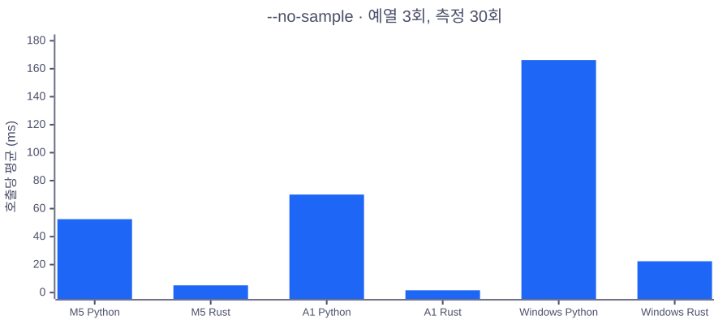

# host-pressure
[English](README.md)

CPU·메모리·시스템 압력을 읽고, 작업을 더 실행할 여유가 있는지 알려 주는 명령줄 도구입니다.

<picture>
  <source media="(prefers-color-scheme: dark)" srcset="https://raw.githubusercontent.com/elfenomenokim/host-pressure/main/docs/demo/dark.gif">
  
</picture>

영상은 Python CLI에 [가상 측정값](docs/demo/fixture.py)을 넣어 기록했습니다. 실제 컴퓨터 성능이 아니라 출력 형식과 판정 동작을 보여 줍니다.

## 설치

```sh
pipx install host-pressure
uv tool install host-pressure
pip install host-pressure
```

Python 3.9 이상이 필요합니다. wheel을 설치하면 Rust 명령과 Python 라이브러리를 함께 쓸 수 있습니다. 소스에서 설치할 때는 Rust도 필요합니다.

macOS arm64, Ubuntu 24.04 arm64, Windows 11 x64에서 두 판본을 실행했습니다. macOS/Linux x86_64 실행은 확인하지 않았습니다.

## 시작하기

상태 한 줄, 실행 여부 판정, 상태 표시줄에 넣을 항목을 차례로 확인합니다. 아래 출력은 가상 측정값으로 CLI를 실행해 얻었습니다. 실제 실행에서는 값이 달라집니다.

```console
$ host-pressure
CPU 16% MEM 72% SWAP 1.5G pressure normal
```

```console
$ host-pressure check
ok
```

```console
$ host-pressure --format '{level} | CPU {cpu} | MEM {mem}'
ok | CPU 16% | MEM 72%
```

```console
$ host-pressure check --memory-busy 60
busy: memory 72% >= 60%
```

`check`의 종료 코드는 `ok`가 **0**, `busy`가 **1**, `overloaded`가 **2**입니다. 마지막 명령은 메모리 기준을 60%로 낮췄으므로 1로 끝납니다.

## 만든 이유

빌드를 하나 더 실행하기 전에 메모리 사용률만 보고 판단하기는 어렵습니다. `host-pressure check`는 CPU·메모리·코어당 부하·디스크 사용률과 운영체제의 압력 신호를 함께 봅니다. 판정과 그 근거를 한 줄로 받습니다.

어느 프로세스가 자원을 쓰는지 찾을 때는 `top`이나 `htop`이 맞습니다. 프로그램에서 프로세스를 다루려면 `psutil`을 쓰면 됩니다. 이 도구는 스크립트가 종료 코드로 다음 작업을 정하거나, 상태 표시줄에 한 줄을 넣거나, macOS 메모리 압력과 Linux PSI를 함께 읽을 때 씁니다.

## 측정

### 기다리지 않는 반복 호출

상태 표시줄이나 즉시 반환해야 하는 스크립트에는 `--no-sample`을 씁니다. CPU 기준값은 읽고 갱신하지만, 카운터가 바뀌지 않았으면 기다리지 않고 `n/a`를 출력합니다. 2026-11-17에 세 컴퓨터 모두 같은 옵션으로 3회 예열한 뒤 30회 실행했습니다. 최대 RSS는 `/usr/bin/time`으로 따로 측정했습니다.

| Host / CPU | Command | Mean (ms) | Peak RSS (MiB) |
|---|---|---:|---:|
| macOS / Apple M5 Pro | `python3 -m host_pressure --no-sample` | 52.5 | 20.8 |
| macOS / Apple M5 Pro | Rust `host-pressure --no-sample` | 5.2 | 9.7 |
| OCI A1 / aarch64¹ | `python -m host_pressure --no-sample` | 70.0 | 15.3 |
| OCI A1 / aarch64¹ | Rust `host-pressure --no-sample` | 1.6 | 2.1 |
| Windows 11 / Ryzen 7 PRO 6850U | `python -m host_pressure --no-sample` | 166.2 | —² |
| Windows 11 / Ryzen 7 PRO 6850U | Rust `host-pressure.exe --no-sample` | 22.4 | —² |

¹ A1의 aarch64 실행은 확인했으나 이번 측정에서 CPU 모델은 확인하지 못했습니다. ² Windows 시간에는 venv 실행기가 포함됩니다. 실행기의 최대 작업 집합에는 Python 자식 프로세스가 빠지므로 메모리 비교값을 싣지 않았습니다.

<picture>
  <source media="(prefers-color-scheme: dark)" srcset="https://raw.githubusercontent.com/elfenomenokim/host-pressure/main/docs/diagrams/no-sample-dark.ko.svg">
  
</picture>

```sh
# macOS: from the source checkout; no CPU sampling wait
PYTHONPATH=src hyperfine --warmup 3 --runs 30 \
  --export-json docs/bench/m5-no-sample.json \
  'python3 -m host_pressure --no-sample' \
  './rust/target/release/host-pressure --no-sample'
PYTHONPATH=src /usr/bin/time -l python3 -m host_pressure --no-sample
/usr/bin/time -l ./rust/target/release/host-pressure --no-sample
# A1: installed Python package and Rust binary
python3 docs/bench/a1-no-sample-bench.py
# Windows: silent temporary venv, removed when finished
powershell -NoProfile -File docs/bench/windows-bench.ps1 -NoSample
```

M5는 Hyperfine 2.0.0, A1은 `perf_counter` 반복 실행, Windows는 PowerShell `Measure-Command`로 쟀습니다. [실행 코드와 원본 출력](docs/bench/)에 각 방법을 남겼습니다. 다른 작업이 돌아가는 컴퓨터에서 잰 값이며 CPU만 분리한 벤치마크는 아닙니다.

### 표본 대기를 포함한 기본 명령

옵션 없이 실행하면 두 판본 모두 쓸 수 있는 CPU 기준값 차이가 없을 때 0.3초 표본을 채취합니다. 카운터가 움직이지 않으면 최대 1초 더 기다릴 수 있습니다. 앞서 측정한 기본 명령에는 이 대기가 포함됐습니다.

| Host | Python mean (ms) | Rust mean (ms) |
|---|---:|---:|
| M5 | 179.7 | 177.5 |
| A1 | 72.1 | 122.4 |
| Windows | 164.2 | 22.2 |

이 표는 `--no-sample`과 다른 동작을 잰 것이므로 시작 속도 비교로 읽으면 안 됩니다. 기본 명령과 원본 실행 결과는 [docs/bench](docs/bench/)에 보관했습니다.

A1에서 판본별 기준값 폴더를 나눠 다시 확인했습니다. Rust를 빠르게 연속 호출하자 30회 중 11회에서 **새 CPU tick이 0개**여서 표본을 채취했습니다. Python은 30회 모두 새 기준값 차이를 읽었습니다. Rust 호출 사이에 **50 ms 간격**을 두자 30회 모두 기준값을 사용했고, 간격을 뺀 호출 시간은 평균 **2.36 ms**였습니다. 두 판본의 소스는 같은 0.3초 대기와 기준값 규칙을 사용합니다. 표본 간격 차이는 발견하지 못했습니다. [진단 원본](docs/bench/a1-default-diagnosis.json).

<picture>
  <source media="(prefers-color-scheme: dark)" srcset="https://raw.githubusercontent.com/elfenomenokim/host-pressure/main/docs/diagrams/cpu-flow-dark.ko.svg">
  
</picture>

## 명령

| 명령·옵션 | 동작 |
|---|---|
| `host-pressure --all` | 부하·디스크·발열·배터리·PSI 중 읽을 수 있는 값 추가 |
| `host-pressure --json` | 전체 측정값과 판정을 JSON으로 출력 |
| `host-pressure check --json` | 판정과 이유만 JSON으로 출력 |
| `host-pressure --watch 2` | 2초마다 출력, Ctrl+C로 종료 |
| `host-pressure wait --until ok --timeout 120` | 여유가 생길 때까지 대기, 시간 초과는 종료 코드 75 |
| `--format TEMPLATE`, `--format-help` | 항목 선택과 자리표시자 목록 |
| `--disk MOUNT` | 읽을 마운트 지정, 여러 번 사용 가능 |
| `--sample 0.5` | 이번 호출에서 CPU 표본 채취 |
| `--no-sample` | CPU 표본을 기다리지 않음 |
| `--consumer ID`, `--state-dir DIR` | CPU 기준값 이름과 저장 폴더 지정 |

자리표시자 값에는 단위가 들어 있습니다. `--watch --json`은 한 줄에 JSON 객체 하나를 씁니다. 프로그램에서 읽을 때는 일반 문자열 대신 JSON을 사용하세요.

### 판정 기준

| 옵션 | busy / overloaded 기본값 |
|---|---|
| `--cpu-busy`, `--cpu-overloaded` | 80 / 95% |
| `--memory-busy`, `--memory-overloaded` | 85 / 95% |
| `--load-busy`, `--load-overloaded` | 코어당 부하 1 / 2 |
| `--disk-busy`, `--disk-overloaded` | 90 / 97% |
| `--swap-busy-gb`, `--swap-overloaded-gb` | 사용 안 함 |

파일은 `--config FILE`, `HOST_PRESSURE_CONFIG`, `$XDG_CONFIG_HOME/host-pressure/config.json` 순으로 선택합니다. 파일 키는 `memory_busy`처럼 쓰고, 환경 변수는 `HOST_PRESSURE_MEMORY_BUSY=80`처럼 씁니다. 값의 우선순위는 명령줄 → 환경 변수 → 파일입니다. 없는 키는 오류로 처리합니다.

PSI는 파일과 환경 변수에서 `psi_cpu_busy`, `psi_cpu_overloaded`, `psi_memory_busy`, `psi_memory_overloaded`, `psi_io_busy`, `psi_io_overloaded`를 설정할 수 있습니다. macOS 커널 압력과 발열 상태의 판정 규칙은 고정입니다. Linux의 PSI는 `psi_*` 임계값으로만 판정하므로, 값을 올리면 판정이 완화됩니다.

CPU 기준값은 `$XDG_STATE_HOME/host-pressure`에 저장합니다. `HOST_PRESSURE_STATE_DIR`로 위치를 바꿀 수 있습니다. 여러 프로그램이 호출한다면 `--consumer`를 각각 지정하세요. 측정 구간은 이전 호출부터 지금까지이며, Rust와 Python이 같은 저장 형식을 씁니다.

### Python

```python
import host_pressure

reading = host_pressure.read(consumer_id="my-tool")
result = host_pressure.verdict(reading)
print(result["level"], result["reasons"])
```

`read(sample=0.5)`는 CPU 표본을 직접 채취합니다. 인수 없는 `verdict()`는 기본 0.2초 표본을 채취합니다. 이미 읽은 값을 넘기는 `verdict(reading)`는 기다리지 않습니다. 라이브러리는 Python 표준 라이브러리만 사용합니다.

## 한계

- 읽지 못한 값은 JSON에서 `null`, 텍스트에서 `n/a`입니다. CPU 값이 없다고 사용률이 0%인 것은 아닙니다.
- Windows에는 부하 평균과 발열 값이 없습니다. 메모리 사용률로 압력을 판정합니다.
- 이번 실행에서는 실제 배터리 잔량을 확인하지 않았습니다. Linux 가상 머신은 발열 값을 제공하지 않을 수 있습니다.
- 짧은 CPU 표본 채취도 카운터 갱신을 기다리며 최대 1초 늘어날 수 있습니다. 최초 기본 호출도 표본을 채취할 수 있습니다.
- macOS 스왑은 압력이 낮아진 뒤에도 남을 수 있어 기본 판정에서 제외합니다.
- `--watch`는 값을 반복 출력합니다. 이력을 저장하거나 알림을 보내지 않으며, 한 번의 `ok`로 지속적인 상태를 판단할 수 없습니다.

## 기여

버그나 실행 결과는 [이슈](https://github.com/elfenomenokim/host-pressure/issues)에 남겨 주세요. 소스 확인 명령: `bash rust/parity.sh`. 작업 구조와 주의사항은 [AGENTS.md](AGENTS.md)에 있습니다.

라이선스: [MIT](LICENSE).
