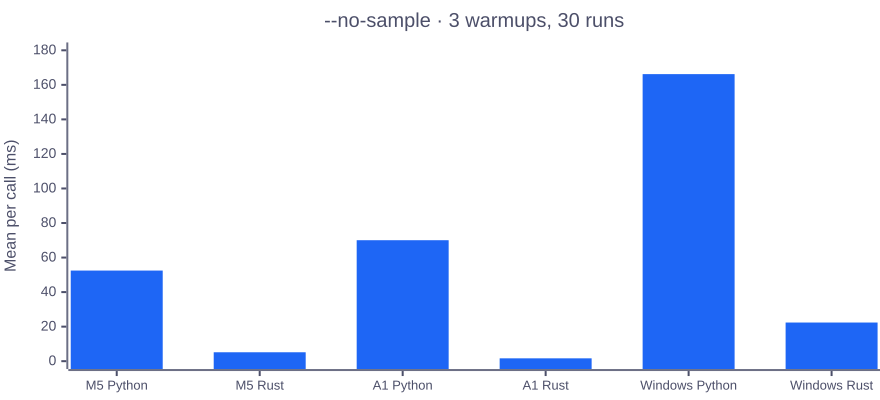

<div align="center">


# host-pressure
[한국어](README.ko.md)

A command-line resource check that tells you whether your machine has room for another job.

Python 3.9+ · Rust

[](https://pypi.org/project/host-pressure/)
[](https://github.com/elfenomenokim/host-pressure/blob/main/LICENSE)

Rust `--no-sample` returns in 5.2 ms; the Python command takes 52.5 ms on the same M5 Pro. Both from the saved 30-run measurement.

[Install](#install) · [Quick start](#quick-start) · [Why](#why)

</div>

<picture>
  <source media="(prefers-color-scheme: dark)" srcset="https://raw.githubusercontent.com/elfenomenokim/host-pressure/main/docs/demo/dark.gif">
  
</picture>

The recording runs the Python CLI with [synthetic readings](docs/demo/fixture.py). It shows formatting and verdicts, not a measurement of a real host.

## Install

```sh
pipx install host-pressure
uv tool install host-pressure
pip install host-pressure
```

Python 3.9+. Wheels install the Rust command and the importable Python package. A source install needs Rust.

| Platform | Observed runs |
|---|---|
| macOS arm64 | Rust command and Python library |
| Linux arm64 | Rust command and Python library on Ubuntu 24.04 |
| Windows x64 | Both commands on Windows 11 |

## Quick start

You can read one line, check whether to start work, or choose fields for a status bar. These outputs were captured from the demo fixture; your readings will differ.

```console
$ host-pressure
CPU 16% MEM 72% SWAP 1.5G pressure normal
```

```console
$ host-pressure check
ok
```

```console
$ host-pressure --format '{level} | CPU {cpu} | MEM {mem}'
ok | CPU 16% | MEM 72%
```

```console
$ host-pressure check --memory-busy 60
busy: memory 72% >= 60%
```

`check` exits **0** for `ok`, **1** for `busy`, and **2** for `overloaded`. The last command exits 1 because it lowers the memory threshold to 60%.

## Why

Before you start another build, a memory percentage alone leaves you guessing. `host-pressure check` combines CPU, memory, load per core, disk usage, and the pressure signals your operating system exposes. You get a verdict and the readings that caused it.

Use `top` or `htop` when you need to find the process using resources. Use `psutil` when you need a general process-management library. Use this command when a script needs an exit code, a status bar needs one line, or you need macOS memory pressure and Linux PSI alongside ordinary usage figures.

## Measurements

### Repeated calls without waiting

For a status bar or a script that must return immediately, use `--no-sample`. It still reads and updates the CPU baseline; if counters have not advanced, CPU prints `n/a` instead of waiting. These are the same flag and 3-warmup/30-run method on all three hosts, measured 2026-11-17. Peak RSS comes from separate `/usr/bin/time` calls.

| Host / CPU | Command | Mean (ms) | Peak RSS (MiB) |
|---|---|---:|---:|
| macOS / Apple M5 Pro | `python3 -m host_pressure --no-sample` | 52.5 | 20.8 |
| macOS / Apple M5 Pro | Rust `host-pressure --no-sample` | 5.2 | 9.7 |
| OCI A1 / aarch64¹ | `python -m host_pressure --no-sample` | 70.0 | 15.3 |
| OCI A1 / aarch64¹ | Rust `host-pressure --no-sample` | 1.6 | 2.1 |
| Windows 11 / Ryzen 7 PRO 6850U | `python -m host_pressure --no-sample` | 166.2 | —² |
| Windows 11 / Ryzen 7 PRO 6850U | Rust `host-pressure.exe --no-sample` | 22.4 | —² |

¹ The A1 architecture was observed; its CPU model was not verified in this run. ² Windows timings include the venv launcher. Its peak working set excludes the Python child, so those memory readings are not comparable and are omitted.

<picture>
  <source media="(prefers-color-scheme: dark)" srcset="https://raw.githubusercontent.com/elfenomenokim/host-pressure/main/docs/diagrams/no-sample-dark.svg">
  
</picture>

```sh
# macOS: from the source checkout; no CPU sampling wait
PYTHONPATH=src hyperfine --warmup 3 --runs 30 \
  --export-json docs/bench/m5-no-sample.json \
  'python3 -m host_pressure --no-sample' \
  './rust/target/release/host-pressure --no-sample'
PYTHONPATH=src /usr/bin/time -l python3 -m host_pressure --no-sample
/usr/bin/time -l ./rust/target/release/host-pressure --no-sample
# A1: installed Python package and Rust binary
python3 docs/bench/a1-no-sample-bench.py
# Windows: silent temporary venv, removed when finished
powershell -NoProfile -File docs/bench/windows-bench.ps1 -NoSample
```

M5 uses Hyperfine 2.0.0, A1 uses a `perf_counter` subprocess loop, and Windows uses PowerShell `Measure-Command`. The saved [runners and raw outputs](docs/bench/) describe each launch method. These are running machines, not isolated CPU benchmarks.

### Default command, including sampling waits

With no flag, both editions fall back to a 0.3-second CPU sample when no usable baseline delta exists. A short sample can extend by up to one second while waiting for counters. The earlier default-command runs include those waits:

| Host | Python mean (ms) | Rust mean (ms) |
|---|---:|---:|
| M5 | 179.7 | 177.5 |
| A1 | 72.1 | 122.4 |
| Windows | 164.2 | 22.2 |

This is a different workload from `--no-sample`, not a startup-speed comparison. Exact default commands and raw runs are retained in [docs/bench](docs/bench/).

On A1, a follow-up run with separate baseline directories explained the reversal: 11 of 30 rapid Rust calls saw **zero new ticks** and used the sample fallback. All 30 Python calls saw a new baseline delta. With **50 ms between Rust calls**, all 30 used the baseline and averaged **2.36 ms per call**, excluding the pause. The source logic uses the same 0.3-second fallback and baseline rules in both editions; no sampling-interval difference was found. See the [recorded diagnosis](docs/bench/a1-default-diagnosis.json).

<picture>
  <source media="(prefers-color-scheme: dark)" srcset="https://raw.githubusercontent.com/elfenomenokim/host-pressure/main/docs/diagrams/cpu-flow-dark.svg">
  
</picture>

## Reference

| Command or flag | Result |
|---|---|
| `host-pressure --all` | Add load, disk, thermal, battery and PSI where available |
| `host-pressure --json` | Full reading and verdict as JSON |
| `host-pressure check --json` | Verdict and reasons as JSON |
| `host-pressure --watch 2` | Repeat every two seconds; Ctrl+C stops it |
| `host-pressure wait --until ok --timeout 120` | Wait for room; exit 75 on timeout |
| `--format TEMPLATE` / `--format-help` | Select fields; values already include units |
| `--disk MOUNT` | Read a mount; repeat for more than one |
| `--sample 0.5` | Take a CPU sample in this call |
| `--no-sample` | Never wait for CPU counters |
| `--consumer ID` / `--state-dir DIR` | Select the CPU baseline and storage directory |

`--watch --json` writes one object per line. Without `--watch`, JSON is formatted across multiple lines. Parse JSON rather than the human-readable line.

### Thresholds

| Threshold flags | Busy / overloaded defaults |
|---|---|
| `--cpu-busy`, `--cpu-overloaded` | 80 / 95 percent |
| `--memory-busy`, `--memory-overloaded` | 85 / 95 percent |
| `--load-busy`, `--load-overloaded` | 1 / 2 load per CPU core |
| `--disk-busy`, `--disk-overloaded` | 90 / 97 percent |
| `--swap-busy-gb`, `--swap-overloaded-gb` | Disabled |

Use `--config FILE`, `HOST_PRESSURE_CONFIG`, or `$XDG_CONFIG_HOME/host-pressure/config.json` for persistent thresholds. Keys use snake case, such as `memory_busy`; unknown keys are errors. Environment overrides use `HOST_PRESSURE_MEMORY_BUSY=80`. Command-line values win over environment values, which win over the file.

Config and environment also accept `psi_cpu_busy`, `psi_cpu_overloaded`, `psi_memory_busy`, `psi_memory_overloaded`, `psi_io_busy`, and `psi_io_overloaded`. macOS kernel pressure and thermal states have fixed verdict mappings. On Linux, PSI is classified by the `psi_*` thresholds only, so raising them relaxes the verdict.

CPU baselines live under `$XDG_STATE_HOME/host-pressure`; `HOST_PRESSURE_STATE_DIR` overrides that directory. Give separate callers their own `--consumer` value. The baseline interval is the time between calls, not a fixed sampling window. Rust and Python share its format.

### Python

```python
import host_pressure

reading = host_pressure.read(consumer_id="my-tool")
result = host_pressure.verdict(reading)
print(result["level"], result["reasons"])
```

`read(sample=0.5)` takes an explicit CPU sample. `verdict()` without a reading samples for 0.2 seconds by default; use `verdict(reading)` to classify an existing reading without waiting. The library uses only the Python standard library.

## Limits

- Missing readings stay `null` in JSON and `n/a` in text. A missing CPU number does not mean 0% usage.
- Windows has no load-average or thermal reading. Its pressure verdict comes from memory load.
- Battery-present readings were not exercised in these runs. Linux virtual machines may expose no thermal zone.
- A short CPU sample can stretch by up to one second while waiting for counters to move. The first default call may also sample.
- macOS swap can remain allocated after pressure falls, so swap thresholds are off by default.
- `--watch` repeats readings; it stores no history and sends no alerts. One `ok` does not describe the machine over time.
- macOS/Linux x86_64 wheels exist, but those backends were not run here.

## Contributing

Issues and platform reports are welcome; run `bash rust/parity.sh` from the source checkout. See [CONTRIBUTING.md](CONTRIBUTING.md) for the checks and the review process, and [AGENTS.md](AGENTS.md) for the code layout and safety rules.

## License

MIT. See [LICENSE](LICENSE).
